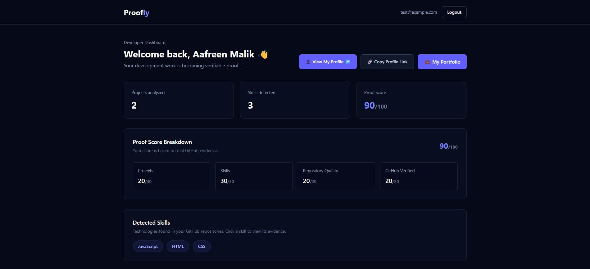
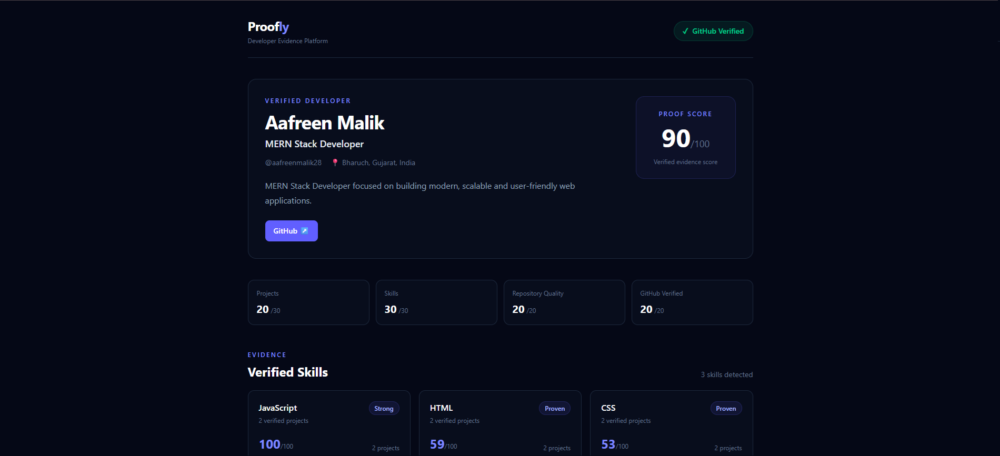
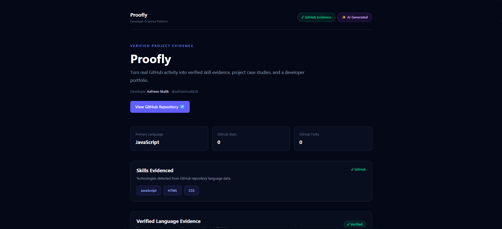

# Proofly

> **Don't just list your skills. Prove them.**

Proofly is a full-stack developer evidence platform that transforms real GitHub activity into **verifiable skill evidence, project case studies, proof scores, and a shareable developer portfolio**.

Instead of simply claiming technologies on a resume, developers can connect their GitHub account and let Proofly analyze their actual repositories to demonstrate what they have built.

## 🚀 Live Application

**Live App:** https://proofly-psmf.onrender.com

**GitHub Repository:** https://github.com/aafreenmalik28/Proofly

---

## 📸 Screenshots

### Developer Dashboard



### Public Developer Profile



### Verified Project Evidence



---

## 💡 The Problem

Developer portfolios and resumes usually contain self-reported skills such as:

- JavaScript
- React
- Node.js
- MongoDB
- HTML & CSS

But recruiters often have to manually inspect GitHub repositories to determine whether those skills are actually demonstrated.

**Proofly turns repository activity into structured evidence.**

Instead of asking recruiters to trust a list of claimed skills, Proofly connects those skills to real development work.

---

## ✨ Key Features

### 🔐 Authentication

Proofly includes a complete authentication system for developers.

- Secure user registration and login
- Password hashing with bcrypt
- JWT-based authentication
- Protected dashboard routes
- Protected portfolio routes
- Persistent authenticated sessions
- Logout support

---

### 🐙 GitHub OAuth Integration

Developers can securely connect their GitHub account using OAuth.

Proofly uses the GitHub connection to retrieve repository information and transform it into structured developer evidence.

Features include:

- GitHub OAuth authorization
- GitHub username verification
- Repository retrieval
- Repository language analysis
- GitHub-backed project evidence
- Secure access-token handling
- OAuth state validation
- Duplicate GitHub account protection

A GitHub account can only be connected to **one Proofly account**, helping protect the integrity of verified profiles.

---

### 📊 Proof Score

Proofly calculates a developer **Proof Score out of 100** based on GitHub-backed evidence.

The score currently considers:

| Category | Maximum Score |
| --- | ---: |
| Projects | 30 |
| Skills | 30 |
| Repository Quality | 20 |
| GitHub Verified | 20 |
| **Total** | **100** |

This makes the score understandable instead of presenting developers with an unexplained number.

The score provides a quick summary of the strength of the evidence available on a developer's Proofly profile.

---

### 🧠 Skill Evidence

Proofly analyzes repository language data to identify technologies demonstrated through real projects.

Instead of simply displaying:

```text
JavaScript
```

Proofly can connect the skill to repository evidence such as:

```text
JavaScript — demonstrated through actual repository language usage
```

This creates a stronger connection between a developer's claimed skills and their real development work.

---

### 📁 Repository Analysis

Connected GitHub repositories are analyzed and transformed into structured project evidence.

Proofly can display information such as:

- Repository name
- Repository description
- Primary language
- Language distribution
- GitHub stars
- GitHub forks
- Repository URL
- Detected skills
- Repository quality signals

This evidence is then used across the dashboard, public profile, project pages, and Proof Score.

---

### ✨ AI-Generated Case Studies

Proofly can generate structured project case studies using AI.

Case studies can include:

- Developer role
- Project summary
- Skills used
- Key contributions

Proofly deliberately distinguishes between:

**✓ GitHub Evidence** — factual repository information

**✨ AI Generated** — AI-written interpretation of that evidence

This distinction is important because AI-generated descriptions should not be presented as verified GitHub facts.

---

### 👤 Public Developer Profiles

Developers can share a public Proofly profile with recruiters, clients, and hiring managers.

A public profile can include:

- Developer name
- Professional title
- Bio
- Location
- GitHub profile
- GitHub verification
- Proof Score
- Score breakdown
- Detected skills
- Repository evidence
- Projects
- AI-generated case studies

Example route:

```text
/u/:username
```

Public profiles can be opened without requiring the viewer to create a Proofly account.

---

### 📁 Public Project Evidence Pages

Individual repositories can have dedicated public evidence pages.

Example route:

```text
/project/:username/:repoName
```

A project evidence page can show:

- Project name
- Developer
- GitHub Evidence badge
- AI Generated badge
- Repository link
- Primary language
- Stars
- Forks
- Skills evidenced
- Language evidence
- AI-generated case study

These pages can be shared directly with recruiters or clients.

---

### 🔗 Developer Portfolio

Proofly includes a developer portfolio system where users can maintain professional information.

Portfolio information can include:

- Professional title
- Bio
- Location
- GitHub
- LinkedIn
- Personal website
- Verified projects
- Verified skills
- Proof Score

Developers can edit and save their portfolio information through protected routes.

---

### 🛡️ Duplicate GitHub Protection

Proofly prevents the same GitHub identity from being connected to multiple Proofly accounts.

If another Proofly account attempts to connect an already-linked GitHub account, the connection is rejected and a friendly warning is shown.

This helps preserve the integrity of Proofly's verification system.

---

## 🔎 GitHub Evidence vs AI Interpretation

One of Proofly's core principles is separating **facts** from **interpretation**.

### GitHub Evidence

Information retrieved or derived from repository data is treated as GitHub-backed evidence.

Examples:

- Repository name
- Repository URL
- Primary language
- Language percentages
- Stars
- Forks

### AI Generated

AI-generated project summaries, roles, and contribution descriptions are clearly labeled:

```text
AI Generated
```

Proofly does **not** label an entire AI-written case study as GitHub verified.

This separation makes the platform more transparent for developers and recruiters.

---

## 🛠️ Tech Stack

### Frontend

- React
- Vite
- JavaScript
- React Router
- Tailwind CSS

### Backend

- Node.js
- Express.js
- REST API
- JWT Authentication
- bcrypt

### Database

- MongoDB
- Mongoose
- MongoDB Atlas

### Integrations

- GitHub OAuth
- GitHub API
- Gemini AI

### Deployment

- Render
- MongoDB Atlas

---

## 🏗️ Architecture

```text
                     ┌────────────────────┐
                     │     Developer      │
                     └─────────┬──────────┘
                               │
                               ▼
                     ┌────────────────────┐
                     │   React Frontend   │
                     │   Vite + Router    │
                     └─────────┬──────────┘
                               │
                            REST API
                               │
                               ▼
                     ┌────────────────────┐
                     │ Express / Node API │
                     └──────┬─────┬───────┘
                            │     │
               ┌────────────┘     └────────────┐
               ▼                               ▼
      ┌─────────────────┐             ┌─────────────────┐
      │  MongoDB Atlas  │             │   GitHub API    │
      │                 │             │     + OAuth     │
      └────────┬────────┘             └─────────────────┘
               │
               ▼
      ┌─────────────────┐
      │ EvidenceSnapshot│
      │ Portfolio       │
      │ Case Studies    │
      └────────┬────────┘
               │
               ▼
      ┌─────────────────┐
      │    Gemini AI    │
      │  Case Studies   │
      └─────────────────┘
```

---

## 🔎 Evidence Architecture

Proofly stores analyzed GitHub information as an **Evidence Snapshot**.

This allows public developer and project pages to use previously analyzed repository evidence instead of making unauthenticated GitHub API requests whenever somebody views a profile.

An evidence snapshot can contain:

- GitHub username
- Analyzed repositories
- Detected skills
- Skill evidence
- Proof Score
- Score breakdown
- Last synchronization time

This architecture also helps keep GitHub access credentials on the backend rather than exposing them through public pages.

---

## 📊 Proof Score Architecture

The Proof Score provides a simple summary of the evidence available for a developer.

```text
Proof Score
│
├── Projects ............... 30 points
├── Skills ................. 30 points
├── Repository Quality ..... 20 points
└── GitHub Verified ........ 20 points
                            ─────────
                              100
```

The breakdown is displayed alongside the final score so users and recruiters can understand how the score was formed.

---

## 🔒 Security

Proofly includes several production-focused security measures.

- Passwords are hashed before storage
- JWT authentication protects private routes
- Secrets are stored using environment variables
- `.env` files are excluded from Git
- GitHub OAuth uses state validation
- GitHub access tokens are not exposed to the frontend
- Sensitive GitHub tokens are excluded from normal user queries
- Duplicate GitHub account linking is prevented
- Public profiles use stored evidence instead of GitHub credentials
- MongoDB Atlas production network access is restricted
- Production secrets are configured through deployment environment variables

---

## 📂 Project Structure

```text
Proofly/
│
├── client/
│   ├── public/
│   └── src/
│       ├── assets/
│       ├── components/
│       ├── layouts/
│       ├── pages/
│       ├── App.jsx
│       ├── config.js
│       └── main.jsx
│
├── server/
│   ├── middleware/
│   ├── models/
│   ├── routes/
│   └── server.js
│
├── screenshots/
│   ├── dashboard.png
│   ├── profile.png
│   └── project.png
│
├── .gitignore
└── README.md
```

---

## ⚙️ Local Development

### Prerequisites

Before running Proofly locally, make sure you have:

- Node.js
- npm
- MongoDB / MongoDB Atlas
- GitHub OAuth application credentials
- Gemini API credentials

---

### 1. Clone the repository

```bash
git clone https://github.com/aafreenmalik28/Proofly.git
cd Proofly
```

---

### 2. Install frontend dependencies

```bash
cd client
npm install
```

---

### 3. Install backend dependencies

```bash
cd ../server
npm install
```

---

### 4. Configure backend environment variables

Create:

```text
server/.env
```

Configure the required values for:

```env
MONGO_URI=
JWT_SECRET=

GITHUB_CLIENT_ID=
GITHUB_CLIENT_SECRET=
GITHUB_CALLBACK_URL=

GEMINI_API_KEY=

FRONTEND_URL=
PORT=5000
```

Example local URLs:

```env
GITHUB_CALLBACK_URL=http://localhost:5000/api/github/callback
FRONTEND_URL=http://localhost:5173
PORT=5000
```

> Never commit `.env` files or API credentials to Git.

---

### 5. Configure frontend environment variables

Create:

```text
client/.env
```

Add:

```env
VITE_API_URL=http://localhost:5000
```

---

### 6. Start the backend

From the `server` directory:

```bash
npx nodemon server.js
```

The API runs locally on:

```text
http://localhost:5000
```

---

### 7. Start the frontend

Open another terminal:

```bash
cd client
npm run dev
```

The frontend runs locally on:

```text
http://localhost:5173
```

---

## 🌐 Production Deployment

The current production MVP is deployed using:

### Frontend

Render Static Site

```text
https://proofly-psmf.onrender.com
```

### Backend

Render Web Service

```text
https://proofly-api-wlwu.onrender.com
```

### Database

MongoDB Atlas

Production configuration uses environment variables rather than hardcoded credentials or production URLs.

---

## 🧪 Production Testing

Proofly v1.0.0 has been tested for the following production flows:

- User registration
- User login
- Logout
- Protected dashboard
- GitHub OAuth connection
- Duplicate GitHub account protection
- Repository analysis
- Proof Score generation
- Portfolio loading
- Portfolio editing
- Portfolio saving
- Public developer profiles
- Public project evidence pages
- Direct React Router routes
- Production MongoDB read/write access
- Public pages without authentication

---

## 🗺️ Future Roadmap

Possible future improvements include:

- Manual GitHub evidence synchronization
- Repository synchronization status
- More advanced repository-quality analysis
- Additional skill-detection signals
- Improved Proof Score algorithms
- Portfolio themes and customization
- More AI-assisted project insights
- Additional developer-platform integrations
- Recruiter-focused profile views
- Recruiter search and discovery
- Custom public profile URLs
- Analytics for profile and project views

---

## 🎯 Project Goal

Proofly explores a simple idea:

> **A developer's portfolio should be backed by evidence, not just claims.**

By combining GitHub activity, structured evidence, AI-assisted interpretation, and public developer profiles, Proofly turns development work into something that can be **shown, shared, and verified**.

---

## 👩‍💻 Author

**Aafreen Malik**

MERN Stack Developer

GitHub: https://github.com/aafreenmalik28

---

## 📌 Release

### Proofly v1.0.0 — Production MVP

The first production release includes:

- Authentication
- GitHub OAuth
- Repository analysis
- Proof Score calculation
- Skill evidence
- AI-generated case studies
- Developer portfolios
- Public developer profiles
- Public project evidence pages
- Production deployment
- Duplicate GitHub protection
- Production security configuration

**Release:** `v1.0.0`

---

## ⭐ Support

If you find Proofly interesting, consider giving the repository a ⭐ on GitHub.

**Don't just list your skills. Prove them.**